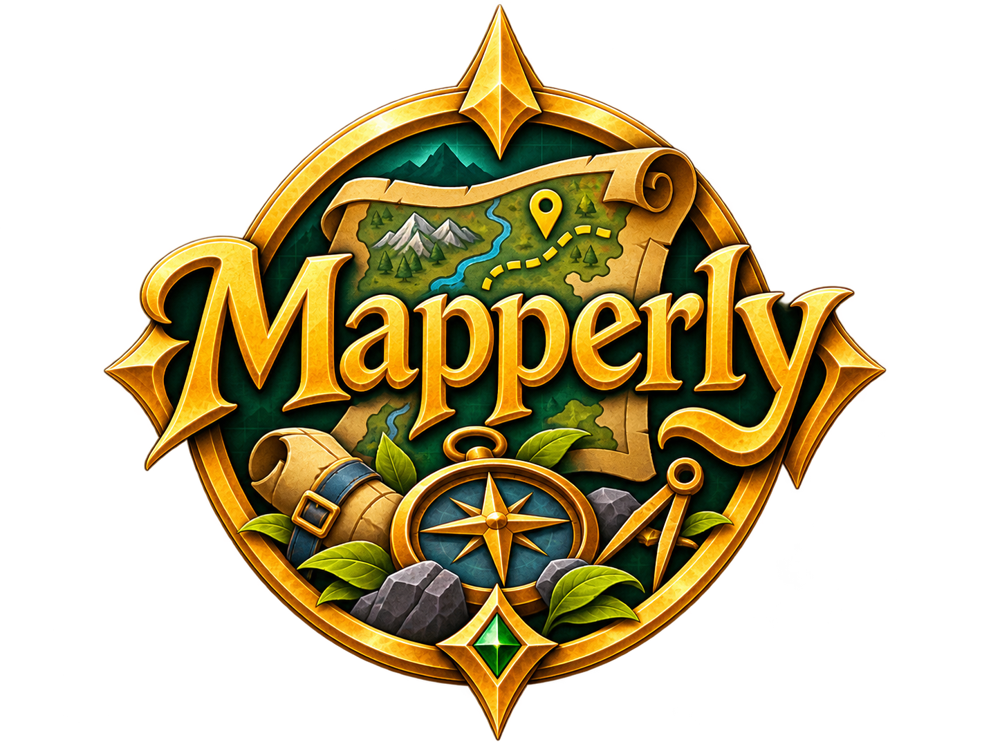

# Mapperly



A cleaner world map for **WoW Forever**. Compact and enlarged views, painted location markers, custom notes and coordinate navigation, styled to fit the original game.

**Current release: 1.0.0** ? **Interface: 16001**

[Download the latest release](https://github.com/Red463/Mapperly/releases/latest) ? [Report an issue](https://github.com/Red463/Mapperly/issues)

## Installation

1. Download **Mapperly-1.0.0.zip** from the release page.
2. Extract the `Mapperly` folder into your WoW Forever `Interface/AddOns` directory.
3. Restart the game or run `/reload` when updating an existing installation.
4. Open the world map with **M**.

Use the release ZIP for installation. GitHub's automatic source archives include development files and use a different outer folder name. Existing Mapperly preferences and notes are preserved when updating.

## Features

- **Two remembered map sizes:** a substantial compact view and an enlarged view with game space around the edges. Drag the compact map's title bar to move it; use Lock to keep it in place.
- **Location markers:** inns, mailboxes, dungeon entrances with level ranges, flight masters, boats/zeppelins, zone exits where supported, and custom notes.
- **Simple layer controls:** toggle individual categories in Filters. In Settings, choose which also appear on continent/world maps. Dungeons are enabled there by default; the other layers default to zone maps.
- **Dedicated settings window:** grouped display, sizing and opacity controls; matching icons beside location names; a live marker-size preview.
- **Optional quest pane:** the quest icon opens or closes the native quest list and remembers your choice.
- **Useful map details:** player/cursor coordinates, recommended zone levels when reliable data is available, optional unexplored-area reveal and a repeatable player-location ping.
- **Coordinate navigation:** enter a destination and follow a movable arrow and distance readout after closing the map.

## Map controls

Hover any icon in the right-hand toolbar for its description. From top to bottom:

| Control | Action |
| --- | --- |
| Close | Close the map. |
| Resize arrows | Switch compact/enlarged view. Arrows indicate the next action. |
| Parent map | Zoom out to the parent zone, continent or world map. |
| My location | Return to your current zone and ping the player arrow. |
| Navigate | Enter X/Y coordinates for the map being viewed. |
| Add note | Name a note at your character's position. Alt-click the map to place one elsewhere. |
| Filters | Toggle Mapperly location categories. |
| Quest symbol | Show or hide the quest log. |
| Reveal | Show unexplored map artwork. This does not grant exploration credit. |
| Lock | Lock or unlock the map position. |
| Settings | Open Mapperly's options window. |

Right-click a custom note to remove it. Shift-click inserts its name and coordinates into an active chat edit box; nothing is sent automatically.

### Navigation

Open the destination map, click Navigate, enter X and Y from **0 to 100** (decimals supported), then press **Start**. Close the map to follow the arrow. Drag the arrow to move it, left-click it to edit, or right-click it to stop. Right-clicking the destination pin or using Stop in the entry window also cancels navigation. Arrival within ten yards clears the destination.

The guide provides a **straight-line bearing**, not a terrain or transport route. It works across adjacent zones in the same world instance and waits when position/facing is unavailable or the destination requires another continent/instance. The arrow position is remembered; destinations are session-only and clear on reload. Gatherly is not required and its navigation is not changed.

### Commands

- `/mapperly` opens the map or its filter menu.
- `/mapperly help` lists commands.
- `/mapperly note 1431 25 50 Meeting point` adds a permanent custom note.
- `/mapperly pin portal 1453 50 50 Destination name` adds a manually verified location.
- `/mapperly debug` prints build/map/pin diagnostics for bug reports.

## Coverage and compatibility

Mapperly includes **47 inn locations and 109 mailboxes** from a pinned public Forever server-database snapshot. It does not read Questie/QuestieDB. Interacting with services records additional discoveries; nearby duplicates are merged. The snapshot can have gaps or stale records. See [service data provenance](Data/Services-SOURCES.md).

Dungeon, flight and transport metadata is bundled from OpenMap. Recommended zone levels use valid client data first, then a cited recommendation table. They are guidance ranges, not quest or entry restrictions. Some zones have no client map links. Reveal metadata may not cover every area.

**Portals are manual locations only:** no verified portal-location dataset is bundled. Enabling the layer does not create portal pins automatically.

The map keeps native pin providers so Questie, Gatherly, RareScanner and other map addons can continue drawing their own markers. Mapperly filters affect its own pins. Other addons that resize or replace the map can conflict. Compatibility depends on the addon mix; please include it with bug reports.

## Development

Python development dependencies are separate from the addon and are not needed in game.

```sh
python -m pip install -r requirements-dev.txt
python tests/run.py
python tests/navigation.py
python tests/services_builder.py
python tools/package.py
```

The package script reads the version from `Mapperly.toc` and writes an installable ZIP to `dist/`. It excludes Git metadata, dependencies, test files, generated-source artwork and database downloads. Source art and image-generation prompts are in `assets/`; large service-database downloads are cached locally and ignored by Git.

The tests use a bundled native-frame double and Lua 5.1 runtime. They cover syntax, saved preferences, map fitting, pin visibility and interactions, settings, opacity, navigation geometry/state and texture encoding. They do not replace in-game rendering and compatibility checks.

## License and credits

**Mapperly's original code and artwork are MIT licensed.** See [LICENSE](LICENSE).

Bundled third-party components retain their own licenses, including BSD-licensed HereBeDragons, MIT OpenMap metadata and GPL-2.0 service-location data. These components are not relicensed under MIT. See [NOTICE.md](NOTICE.md), [Data/SOURCES.md](Data/SOURCES.md) and the license files in `Libs/`.

[Changelog](CHANGELOG.md)
